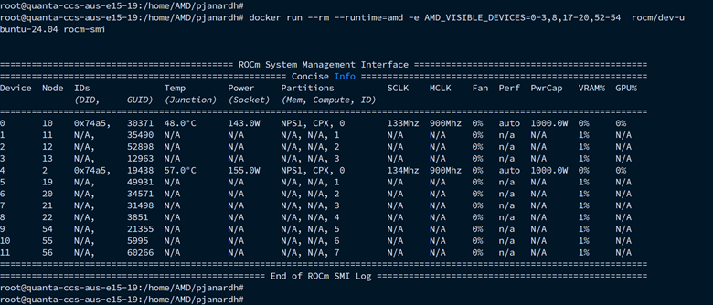

GPU Partitioning
================

GPU partitioning divides a single physical GPU into multiple logical GPUs. The AMD Container Toolkit supports partitioned GPUs starting with version 1.1.0. Each partition appears to containers as a separate GPU, so you can assign partitions to different containers for workload isolation and better utilization.

Partitioning is configured on the host with ``amd-smi set --compute-partition`` and ``amd-smi set --memory-partition``. See the `AMD SMI documentation <https://rocm.docs.amd.com/projects/amdsmi/en/latest/>`_ for the supported schemes on your GPU.

.. note::
   Partitioned GPUs behave identically to physical GPUs within containers. Applications and monitoring tools like ``rocm-smi`` or ``amd-smi`` detect and report them as separate devices. ROCm 6.4.1 or newer is required inside the container to view and verify partitioned GPUs.

After Changing the Partitioning Scheme
--------------------------------------

Changing the partitioning scheme changes the GPU topology that the toolkit sees. After every change:

1. Stop the running GPU containers.
2. Regenerate and validate the :doc:`CDI specification <cdi-guide>`:

   .. code-block:: bash

      sudo amd-ctk cdi generate
      sudo amd-ctk cdi validate

3. If the :doc:`GPU Tracker <gpu-tracker>` is enabled, reset it:

   .. code-block:: bash

      sudo amd-ctk gpu-tracker reset

4. Restart the containers.

Inspecting Partition Status
---------------------------

Run ``amd-smi`` inside a container to check whether each GPU is partitioned and which scheme is in use:

.. code-block:: bash

   docker run --rm --device amd.com/gpu=all rocm/dev-ubuntu-24.04 amd-smi

Selecting Partitions
--------------------

Partitioning can produce a large number of logical GPUs. Partitions of the same physical GPU are numbered contiguously, so ranges are the easiest way to select them.

With the AMD container runtime, ``AMD_VISIBLE_DEVICES`` accepts ranges and lists:

.. code-block:: bash

   docker run --rm --runtime=amd -e AMD_VISIBLE_DEVICES=0-3,8,17-20,52-54 rocm/dev-ubuntu-24.04 amd-smi

This command grants the container access to GPUs 0 through 3, 8, 17 through 20, and 52 through 54.

With CDI, request each partition by its device name. List the names with ``amd-ctk cdi list``. It reads the GPUs from the host, not from the specification, so regenerate the specification after a partitioning change before using the listed names:

.. code-block:: bash

   docker run --rm --device amd.com/gpu=0 --device amd.com/gpu=1 rocm/dev-ubuntu-24.04 amd-smi

Next Steps
----------

- :doc:`Running Workloads <running-workloads>` for selecting GPUs with each container runtime.
- :doc:`GPU Tracker <gpu-tracker>` to give containers exclusive access to partitions.
